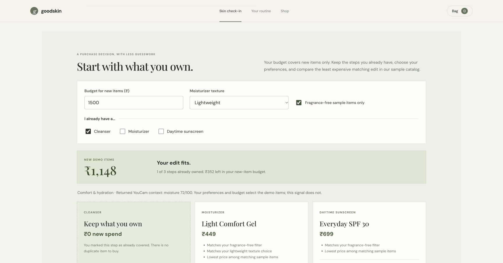
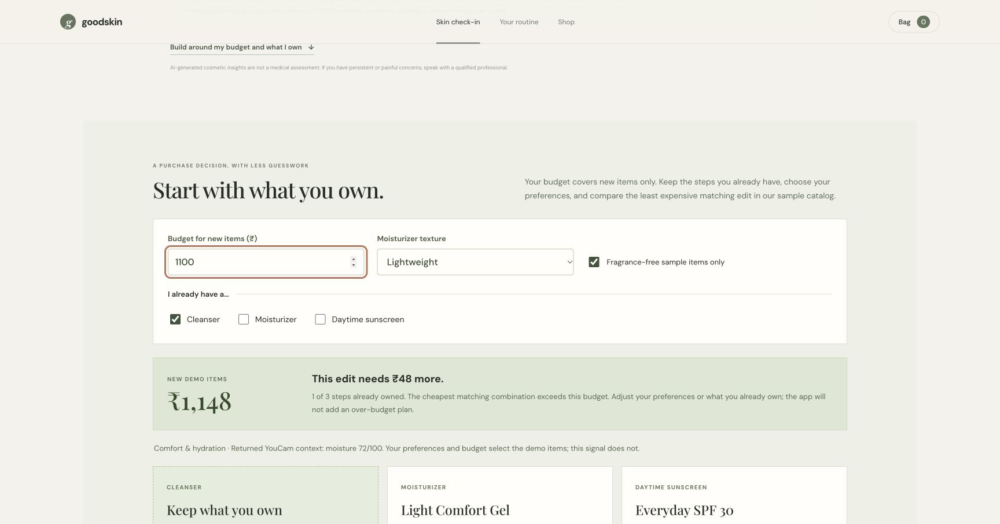

# Goodskin

**Skincare, with context.** Goodskin connects a consent-based YouCam skin check-in to a budget-aware purchase decision: keep the steps you already own, choose a shopping focus, and fit only the missing items to your budget.

## Why it exists

The specific audience hypothesis is a first-time skincare shopper in India, before a purchase, with a limited budget and part of a routine already at home. Goodskin adds a decision step between analysis and shopping. People choose a focus and can see a related returned signal as context. The planner then retains owned steps, filters an illustrative catalog by the shopper's preferences, and minimizes the cost of missing steps. A skin score never assigns a concern or ranks product suitability. Real customer validation remains to be done.

### An observable shopping decision

With a ₹1,500 budget, an already-owned cleanser, and a lightweight / fragrance-free preference, the sample edit contains Light Comfort Gel (₹449) and Everyday SPF 30 (₹699): ₹1,148 of new demo items and ₹352 remaining. Lower the budget to ₹1,100 and the app shows the ₹48 gap and disables adding the plan. Owned steps cost ₹0 in the new-item budget. No claims about real product savings or clinical suitability are made.




## Prototype status

- Responsive, accessible single-page storefront with photo selection, validation, consent, a routine shelf, and a working add-to-bag interaction. Before upload, the browser checks the minimum image dimension, scales oversized photos to YouCam's documented limit, and converts WebP to JPEG.
- Server-side YouCam AI Skin Analysis request flow uses the [v2.0 File API](https://docs.perfectcorp.com/develop/quick_start_guide) and [v2.1 Skin Analysis API](https://docs.perfectcorp.com/reference/ai_skin_analysis/v2.1). The browser sends the selected photo to this app; the server initializes YouCam's file upload, uploads directly to the signed URL, starts a task, and polls for the result. A bundled AI-generated synthetic portrait lets judges explore the flow without using a real person's photo. Select it, review the consent notice, and start the analysis manually.
- The API key is read from server environment variables. The image is held in memory for the request and is not written to disk by this app.
- Results are shown only when returned by YouCam. There are no fabricated fallback scores. `/api/health` reports whether the API key is configured without exposing it.
- The shopper chooses a temporary focus (keep it simple, comfort, texture, or sun care). When a matching API signal exists it is shown with its original value and a plain-language limit; otherwise Goodskin says none was returned. The choice and result stay in the current page only.
- The planner uses seven sample catalog entries. It keeps owned steps, applies texture and fragrance preferences, then finds the least expensive complete combination for the missing steps. It explains each selection, shows matching alternatives, and blocks adding a plan that exceeds the budget. Names, prices, and attributes are illustrative data.
- The bag supports quantity changes and removing an item. Adding a plan skips exact products already in the bag. A downloadable decision card contains the selected preferences, prices, and optional displayed cosmetic context, without a photo, API credential, or task ID.
- **Privacy control:** “Clear check-in” removes the selected photo preview and results from the current page and returns to the consent step. Goodskin stores no profile or history.
- Replacing or removing a photo resets the prior result and consent. The browser stops waiting for the old request and ignores stale responses; a request already sent to YouCam may still finish there.

## Run locally

Requires Node.js 20 or later.

```sh
cp .env.example .env
# Set YOUCAM_API_KEY in .env. Keep this file private.
npm start
```

Run `npm test` for the planner tests. They check the minimum against exhaustive eligible combinations, all owned-step subsets, exact budget boundaries, invalid input, score-independent selection, receipts, and avoiding duplicate bag items.

To enable live analysis, create and verify your YouCam API account through the India portal, redeem the promotion from the email under **Account → Redeem Code**, then create an API key in the account console. Copy the **API Key** (not the separate Secret Key) into `YOUCAM_API_KEY` in your local `.env` file; never commit or paste it into Devpost. The Secret Key is only needed if you later configure webhook signature verification.

Open <http://localhost:4173>. The check-in accepts JPG, PNG, or WebP files up to 10 MB. The browser prepares an API upload with a short side of at least 480 px and a long side no greater than 2560 px. The configured API origin, `https://yce-api-01.makeupar.com`, matches the server in Perfect Corp's current API examples. Confirm the API server shown in your India account console before the first live request; use the server assigned to that account if it differs.

## Privacy and limitations

The photo is sent to YouCam for processing after the user checks the consent box. Goodskin does not persist the image, but the YouCam API's own processing and retention terms apply. Do not upload anyone else's image without permission. This prototype offers cosmetic observations, not medical advice. The routine products and prices are illustrative and do not link to a retailer or place orders.

## Hackathon submission draft

**Project name:** Goodskin  
**Tagline:** Skincare, with context.  
**Built with:** Node.js, HTML, CSS, JavaScript, YouCam AI Skin Analysis API

**License:** MIT (see `LICENSE`).

**Description:** Goodskin helps a shopper move from a consent-based YouCam skin check-in to a transparent shopping edit. A visitor reviews returned cosmetic signals and chooses a focus, then sets a budget and marks the steps already owned. The planner filters a seven-item illustrative catalog by preferences, finds the least expensive missing-step combination, explains the selection, and shows any budget gap. It adds only missing items to a removable bag and can download a decision card. An AI score does not diagnose a need or select products. Clear check-in removes the photo preview and results. The key stays server-side; the app saves no photos, profiles, or check-in history. There is no checkout or real product listing.

**Baseline narrated demo:** [`outputs/goodskin-demo-explained.mp4`](outputs/goodskin-demo-explained.mp4) (2:29, 1080p, H.264 + AAC speech) explains the version before the budget-planner upgrade. It is an edited screenshot walkthrough with synthetic narration, not a continuous interaction recording. Its [transcript](outputs/goodskin-demo-explained-transcript.txt), [captions](outputs/goodskin-demo-explained.srt), and [preview](outputs/goodskin-demo-preview.html) are included for reference. A final 1–3 minute video must still show actual interaction footage of the upgraded flow, then be uploaded publicly to YouTube or Vimeo and linked in Devpost. The current localhost app is not a public hosted build; judge access also remains to be arranged.

### Narrated walkthrough (2:29)

1. **0:00 — What should I explore first?**
2. **0:12 — Meet Goodskin**
3. **0:25 — Start with a photo**
4. **0:38 — Ask before sending**
5. **0:49 — YouCam does the analysis**
6. **1:01 — Read the returned signals**
7. **1:19 — The shopper chooses the focus**
8. **1:34 — Keep the next step small**
9. **1:49 — Explore an item in the bag**
10. **2:02 — Clear the check-in**
11. **2:15 — Skincare, with context.**

## Judging fit

- **Implementation:** The official YouCam file and Skin Analysis task workflow is implemented in the server; this submission should only be described as live-verified after a successful analysis run.
- **Design:** A complete, responsive customer journey from consent through result to product discovery.
- **Impact:** Gives a first-time skincare shopper a guided starting point while setting appropriate expectations for image-based analysis.
- **Idea:** Connects cosmetic context to a shopper-controlled budget and reuse decision, with inspectable cost reasoning and a visible refusal to exceed the budget.
- **Validation status:** This is a prototype and a product hypothesis. No external user study or purchase-conversion result is claimed yet. A next validation round should ask a few first-time skincare shoppers to compare the current flow with an undirected product catalog, then record whether they can explain the signal limits and choose a routine they feel comfortable exploring.
